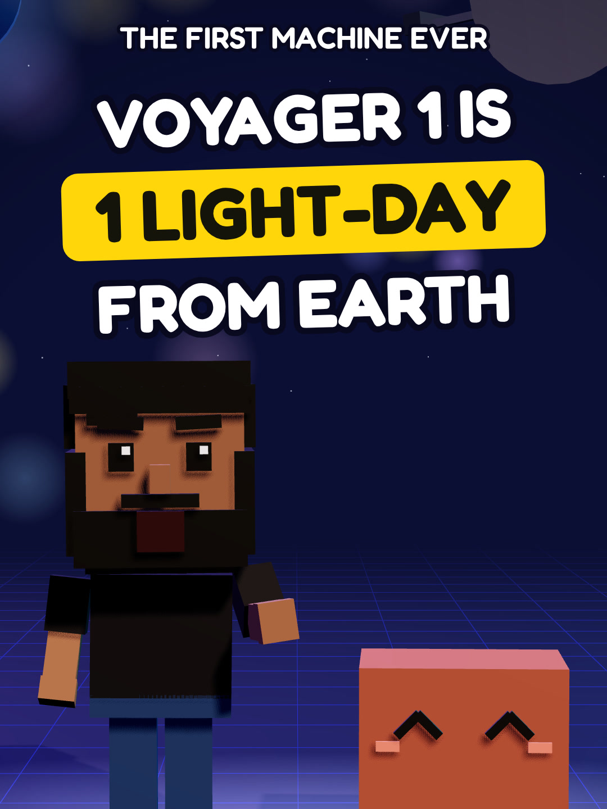

# 3D Cartoon Reels: a skill for Claude

Make vertical 3D cartoon YouTube Shorts and Reels, where a blocky you and a little orange
sidekick explain a topic, **built entirely with code**: Three.js + headless Chrome + ffmpeg.
Voices come from local Kokoro TTS. Sound effects and music are synthesized, so you need no
ElevenLabs, stock audio, or API keys.



## What it does
1. Writes a two-character script (with a hook, numbered steps, and a call to action).
2. Generates both voices locally and cuts and aligns every line.
3. Builds a deterministic Three.js voxel scene with lip-synced mouths, blinks, a camera cut on
   every line, and slow push-ins.
4. Adds word-by-word captions with yellow keywords, top section labels, and animated cards
   (counters, typing, stamps, checklists).
5. Mixes whooshes, pops, typing, a chime and a calm music loop, ducked under the voice, at
   about -14 LUFS.
6. Renders 1080x1920 at 30 fps, checks the transcript against the script, and makes thumbnails.

## Install

**Claude (claude.ai / desktop):** Settings → Capabilities → Skills → upload the
`3d-cartoon-reels` folder (zip it first).

**Claude Code:**
```bash
git clone https://github.com/<you>/3d-cartoon-reels-skill.git
cp -r 3d-cartoon-reels-skill/3d-cartoon-reels ~/.claude/skills/
```

Then ask: *"Make a 50-second 3D cartoon Short about <topic>, ending with 'Subscribe to my channel'."*

## Requirements
Node 18+, Python 3.10+, ffmpeg, and Google Chrome. `scripts/setup.sh` installs the rest and
downloads the voice and Whisper models (~400 MB, from GitHub releases).

## Layout
```
3d-cartoon-reels/
  SKILL.md                     instructions Claude follows
  scripts/setup.sh             one-time project setup
  scripts/render.js            frames -> mp4 (video / stills / thumb modes)
  scripts/voice.py             Kokoro TTS -> vo.wav + line/word timings + mouth envelope
  scripts/mix.py               synthesized SFX + music, sidechain duck, loudness
  scripts/transcribe.py        Whisper (sherpa-onnx) transcript check
  templates/comp.html          the Three.js scene (edit the PER-VIDEO CONFIG block)
  examples/voyager-light-day/  script.json, script.md, thumbnail
```

## Credits
The style is inspired by @what.if.3d and @canwebuildthis. The workflow is adapted from
@heyalok.ai's free guide. Kokoro TTS (Apache-2.0), Three.js (MIT), and sherpa-onnx (Apache-2.0)
are used under their own licenses.
